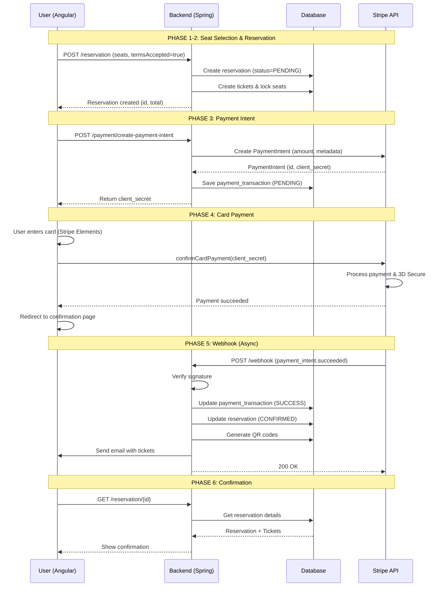

# 💳 Payment Flow - Stripe Integration

## 📋 Table of Contents
1. [Architecture Overview](#architecture-overview)
2. [Customer Journey](#customer-journey)
3. [Stripe API Calls](#stripe-api-calls)
4. [Database Schema](#database-schema)
5. [Sequence Diagram](#sequence-diagram)
6. [Security & Best Practices](#security--best-practices)

---

## 🏗️ Architecture Overview

```
┌─────────────┐     ┌──────────────┐     ┌──────────────┐
│   Angular   │────▶│  Spring Boot │────▶│    Stripe    │
│   Frontend  │◀────│   Backend    │◀────│     API      │
└─────────────┘     └──────────────┘     └──────────────┘
                           │
                           ▼
                    ┌──────────────┐
                    │  PostgreSQL  │
                    │  (minimal    │
                    │  traceability)│
                    └──────────────┘
```

---

## 🛒 Customer Journey - Step by Step

### **Phase 1: Seat Selection & Cart** 🎬

```
User Actions:
1. Browse films
2. Select projection (date/time)
3. Select seats (multiple)
4. Choose price type per seat (Normal, Reduced, Child, Senior)

Frontend State:
{
  filmProjectionId: 123,
  seats: [
    { seatId: 45, priceTypeId: 1 },  // Normal
    { seatId: 46, priceTypeId: 3 }   // Child
  ]
}
```

---

### **Phase 2: Reservation Creation** 📝

```
POST /reservation
Body: {
  userId: 42,
  filmProjectionId: 123,
  termsAccepted: true,        ← REQUIRED
  marketingConsent: false,
  tickets: [
    { seatId: 45, priceTypeId: 1, basePrice: 12.50 },
    { seatId: 46, priceTypeId: 3, basePrice: 8.00 }
  ]
}

Response: {
  id: 789,
  referenceNumber: "RES-2024-001234",
  status: "PENDING",
  totalAmount: 20.50,
  expirationDate: "2024-12-21T18:45:00" // 15 min to pay
}
```

**Backend Logic:**
1. ✅ Validate `termsAccepted = true` (else 400 Bad Request)
2. ✅ Check seat availability
3. ✅ Calculate prices with discounts
4. ✅ Create reservation (status: PENDING)
5. ✅ Lock seats for 15 minutes
6. ✅ Return reservation details

---

### **Phase 3: Payment Intent Creation** 💰

**Frontend initiates payment:**

```javascript
// Frontend calls backend
POST /payment/create-payment-intent
Body: {
  reservationId: 789
}
```

**Backend creates Stripe Payment Intent:**

```java
// Backend → Stripe API
POST https://api.stripe.com/v1/payment_intents
Headers:
  Authorization: Bearer sk_test_XXXXX

Body:
  amount: 2050                    // 20.50 EUR in cents
  currency: eur
  metadata: {
    reservationId: "789",
    referenceNumber: "RES-2024-001234"
  }
  payment_method_types: ["card"]
  
Stripe Response:
{
  id: "pi_3QXxxxxxxxxxxxx",
  client_secret: "pi_3QXxxxxxxxxxxxx_secret_yyyyyyyy",
  status: "requires_payment_method",
  amount: 2050,
  currency: "eur"
}
```

**Backend saves transaction:**

```sql
INSERT INTO payment_transaction (
  reservation_id,
  stripe_payment_intent_id,
  amount,
  currency,
  status
) VALUES (
  789,
  'pi_3QXxxxxxxxxxxxx',
  20.50,
  'EUR',
  'PENDING'
);
```

**Backend returns to Frontend:**

```json
{
  clientSecret: "pi_3QXxxxxxxxxxxxx_secret_yyyyyyyy",
  amount: 20.50,
  currency: "EUR"
}
```

---

### **Phase 4: Payment Form (Stripe Elements)** 💳

**Frontend uses Stripe Elements:**

```javascript
// Frontend loads Stripe.js
<script src="https://js.stripe.com/v3/"></script>

const stripe = Stripe('pk_test_XXXXX');  // Public key
const elements = stripe.elements();
const cardElement = elements.create('card');
cardElement.mount('#card-element');

// User enters card details
// Stripe.js handles PCI compliance (no card data touches your server)

// Submit payment
const { error, paymentIntent } = await stripe.confirmCardPayment(
  clientSecret,  // From backend
  {
    payment_method: {
      card: cardElement,
      billing_details: {
        name: 'John Doe',
        email: 'john@example.com'
      }
    }
  }
);

if (error) {
  // Show error to user
  console.error(error.message);
} else if (paymentIntent.status === 'succeeded') {
  // Payment successful!
  // Redirect to confirmation page
  window.location.href = '/reservation/confirmation?ref=RES-2024-001234';
}
```

**What happens in Stripe:**
1. ✅ Card validation
2. ✅ 3D Secure (if required)
3. ✅ Payment processing
4. ✅ Webhook sent to backend

---

### **Phase 5: Webhook Confirmation** 🔔

**Stripe sends webhook to backend:**

```
POST https://your-domain.com/api/payment/webhook
Headers:
  Stripe-Signature: t=1234567890,v1=xxxxx

Body (Event):
{
  id: "evt_1QXxxxxxxxxxxxx",
  type: "payment_intent.succeeded",
  data: {
    object: {
      id: "pi_3QXxxxxxxxxxxxx",
      status: "succeeded",
      amount: 2050,
      metadata: {
        reservationId: "789",
        referenceNumber: "RES-2024-001234"
      }
    }
  }
}
```

**Backend Webhook Handler:**

```java
@PostMapping("/webhook")
public ResponseEntity<String> handleWebhook(
    @RequestBody String payload,
    @RequestHeader("Stripe-Signature") String signature
) {
    // 1. Verify signature (security)
    Event event = Webhook.constructEvent(payload, signature, webhookSecret);
    
    // 2. Handle event
    if ("payment_intent.succeeded".equals(event.getType())) {
        PaymentIntent intent = (PaymentIntent) event.getData().getObject();
        String reservationId = intent.getMetadata().get("reservationId");
        
        // 3. Update database
        paymentService.confirmPayment(intent.getId());
        reservationService.confirmReservation(Long.parseLong(reservationId));
        
        // 4. Generate QR codes
        ticketService.generateQRCodes(reservationId);
        
        // 5. Send email with tickets
        emailService.sendTickets(reservationId);
    }
    
    return ResponseEntity.ok("Webhook received");
}
```

**Database updates:**

```sql
-- Update payment transaction
UPDATE payment_transaction
SET status = 'SUCCESS', paid_at = NOW()
WHERE stripe_payment_intent_id = 'pi_3QXxxxxxxxxxxxx';

-- Update reservation
UPDATE reservation
SET status = 'CONFIRMED', confirmation_date = NOW()
WHERE id = 789;

-- Generate QR codes for tickets
UPDATE ticket
SET qr_code = 'QR_CODE_BASE64', qr_code_generated_at = NOW()
WHERE reservation_id = 789;
```

---

### **Phase 6: Confirmation & Email** ✅

**Backend sends confirmation email:**

```
To: john@example.com
Subject: 🎬 Your Cinema Tickets - RES-2024-001234

Body:
  Dear John,
  
  Your reservation is confirmed!
  
  Film: Inception
  Date: 21 Dec 2024, 20:00
  Seats: A12, A13
  Total Paid: €20.50
  
  Attached: tickets-RES-2024-001234.pdf
  
  [QR Codes for entry]
```

**Frontend shows confirmation page:**

```
✅ Payment Successful!

Reservation: RES-2024-001234
Amount: €20.50
Status: CONFIRMED

📧 Tickets sent to: john@example.com
📱 Show QR codes at cinema entrance

[Download PDF] [View Tickets]
```

---

## 🔄 Sequence Diagram



---

## 💾 Database Schema

### **payment_transaction Table**

```sql
CREATE TABLE payment_transaction (
    id BIGSERIAL PRIMARY KEY,
    reservation_id BIGINT NOT NULL REFERENCES reservation(id),
    stripe_payment_intent_id VARCHAR(255) UNIQUE NOT NULL,
    amount DECIMAL(10,2) NOT NULL,
    currency VARCHAR(3) DEFAULT 'EUR',
    status VARCHAR(20) NOT NULL,
    -- SUCCESS, FAILED, PENDING, REFUNDED
    stripe_payment_method VARCHAR(50),
    -- card, paypal, etc.
    paid_at TIMESTAMP,
    created_at TIMESTAMP DEFAULT NOW(),
    updated_at TIMESTAMP DEFAULT NOW()
);

CREATE INDEX idx_payment_reservation ON payment_transaction(reservation_id);
CREATE INDEX idx_payment_stripe_id ON payment_transaction(stripe_payment_intent_id);
```

---

## 🔐 Security & Best Practices

### **1. Webhook Signature Verification** 🔒

```java
// ALWAYS verify webhook signature
String signature = request.getHeader("Stripe-Signature");
Event event = Webhook.constructEvent(payload, signature, webhookSecret);

// This prevents:
// - Fake webhook calls
// - Man-in-the-middle attacks
```

### **2. Idempotency** 🔄

```java
// Stripe can send same webhook multiple times
// Use idempotency key or check if already processed
if (paymentTransaction.getStatus().equals("SUCCESS")) {
    return; // Already processed
}
```

### **3. Amount Verification** ✅

```java
// ALWAYS verify amount matches reservation
if (!paymentIntent.getAmount().equals(reservation.getTotalAmount() * 100)) {
    throw new SecurityException("Amount mismatch!");
}
```

### **4. Never Store Card Details** ⛔

```
❌ NEVER store:
- Card numbers
- CVV
- Expiration date

✅ Stripe handles PCI compliance
✅ Only use Stripe.js in frontend
✅ Card data never touches your server
```

### **5. Test Mode** 🧪

```java
// Use test keys for development
stripe.api_key = "sk_test_XXXXX"  // Secret key (backend)
Stripe('pk_test_XXXXX')           // Public key (frontend)

// Test cards:
4242 4242 4242 4242  // Success
4000 0000 0000 9995  // Declined
4000 0025 0000 3155  // 3D Secure required
```

---

## 🚀 Next Steps

### **Implementation Order:**

1. ✅ Create `payment_transaction` table (V015 migration)
2. ✅ Add Stripe dependencies to `pom.xml`
3. ✅ Create StripeConfig with API keys
4. ✅ Create PaymentService (create intent, confirm)
5. ✅ Create PaymentController (endpoints)
6. ✅ Create WebhookController (handle callbacks)
7. ✅ Frontend: Integrate Stripe Elements
8. ✅ Testing with test cards
9. ✅ Email service for tickets

---

## 📚 Resources

- **Stripe Documentation**: https://stripe.com/docs/api
- **Stripe Java SDK**: https://github.com/stripe/stripe-java
- **Stripe Elements**: https://stripe.com/docs/stripe-js
- **Webhooks Guide**: https://stripe.com/docs/webhooks
- **Test Cards**: https://stripe.com/docs/testing

---

**🎉 Ready to implement? Let's start with the database migration!**


